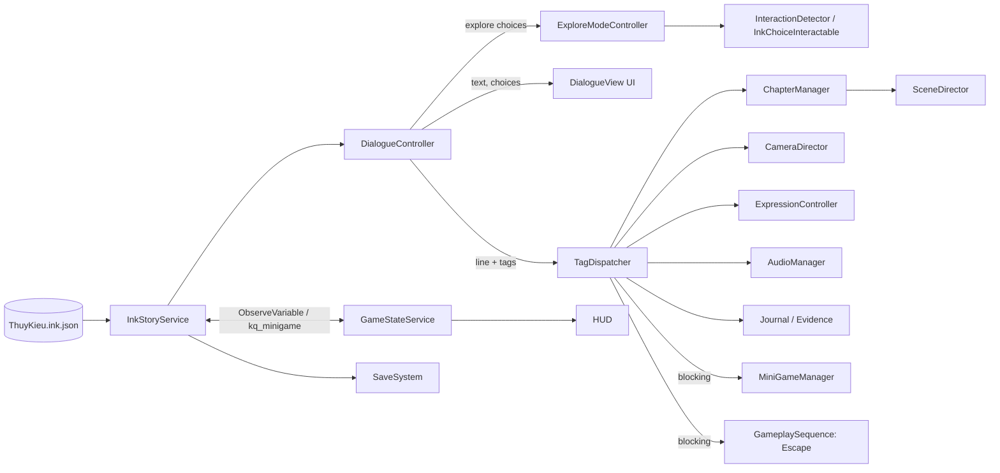

# THÚY KIỀU: KIẾM TIỀN CÓ GÌ KHÓ NHỈ?
## Thiết kế chi tiết & Kế hoạch thực hiện — Unity, nhóm 6 người

Phiên bản 2.0 · 30/09/2026 · Môn PRU213
Tài liệu đi kèm: `ThuyKieuProject_4_Chuong_v2.ink` (kịch bản đã sửa) · `Quan_ly_cong_viec_PRU213_ThuyKieu_Unity_v2.xlsx` (bảng task đã phân công)

---

## 0. Tóm tắt các quyết định

| Hạng mục | Trước | Sau (v2) | Lý do |
|---|---|---|---|
| Engine | Unreal Engine + UnrealSharp | **Unity 6 LTS (URP)** | Tiêu chí chấm là *"Tiêu chí đánh giá dự án Unity Game"*, 30% điểm kỹ thuật chấm *"sử dụng đúng các kỹ thuật trong Unity (prefabs, physics, animation…)"*. Làm bằng Unreal có nguy cơ mất phần lớn điểm kỹ thuật. |
| Nhân vật & biểu cảm | MetaHuman (chỉ có trên Unreal) | **VRoid Studio → UniVRM** (blendshape biểu cảm) + **Mixamo** (animation) | Miễn phí, chạy được trên Unity và WebGL, có sẵn biểu cảm + khẩu hình. |
| Cinematic | Level Sequence | **Cinemachine 3 + Timeline** | Tương đương trong Unity. |
| Kịch bản | Ink | **Ink (giữ nguyên)** qua `ink-unity-integration` | Ink runtime vốn viết bằng C#, chạy thẳng trong Unity, ít rủi ro hơn UnrealSharp. |
| Nền tảng | Windows | **Windows + WebGL** | Điểm cộng "chơi trên nhiều nền tảng" (+5%). |
| Thời gian | Không rõ | **30/09 → 30/10/2026**, 5 sprint | Khớp với dòng thời gian trong file Excel. |
| Phân công | 54 task, 31 task chưa có người/ngày | **58 task**, đủ người phụ trách + ngày, mỗi người 34–40 ngày-người | Để chia việc cho 6 người mà không chờ nhau. |

> **Việc cần làm ngay:** Task 1–4 trong Excel cũ (Unreal) đã đánh dấu "Hoàn thành", nhưng phải **làm lại trên Unity** trong Sprint 0 (30/09–02/10). Phần kiến trúc (GameManager, DialogueManager…) vẫn dùng lại được, vì chỉ đổi engine chứ không đổi thiết kế.

---

## 1. Rà soát tài liệu: các vấn đề đã tìm thấy và cách sửa

| # | Tài liệu | Vấn đề | Mức | Đã sửa trong v2 |
|---|---|---|---|---|
| 1 | PDF + Excel | Dùng Unreal/UnrealSharp/MetaHuman trong khi môn chấm Unity | **Nghiêm trọng** | Chuyển toàn bộ sang Unity (mục 0, 4) |
| 2 | Ink | Chương 4: 3 lựa chọn đối đầu loại trừ nhau, nên người chơi **luôn chỉ thấy 1 lựa chọn**. Chạy thử 2000/2000 lượt đều ra 1 lựa chọn. Đây chính là "choice giả" mà PDF mục 3 nói phải tránh | **Nghiêm trọng** | 3 lựa chọn mở khóa theo bằng chứng / tỉnh táo / danh tiếng, cộng 1 lựa chọn "Kể lại sự thật" luôn có. Kết quả: 2–4 lựa chọn ở 97% lượt chơi |
| 3 | Ink | Chỉ số **Danh tiếng** không ảnh hưởng gì: nhánh "nhờ danh tiếng" lại kiểm tra `tinh_tao < 3` | Cao | Nhánh danh tiếng dùng `danh_tieng >= 3`; lựa chọn thương lượng C3 cũng mở khóa theo danh tiếng |
| 4 | Ink | 89% lượt chơi ra ending "reflective" (vì `tu_trong >= 4` rất khó đạt). Lời kết còn kể Kiều "kiếm tiền bằng cách khiến người khác chịu thiệt" dù người chơi không làm sai | Cao | Thêm biến `lam_sai`; 3 sắc thái kết: **bright / warm / reflective** (tỉ lệ 12% / 55% / 33%) |
| 5 | Ink | Kim Trọng hỏi, Kiều kể "Đàn thuê. Viết thư thuê. Buôn vải." dù chỉ làm 2/3 việc | TB | Chỉ kể những việc đã làm, kèm số tiền thật `{tien}` |
| 6 | Ink | C2: Kiều nói "Mã Giám Sinh bảo bà trả thiếu tiền" dù người chơi có thể không nghe lén | TB | Rẽ nhánh theo `nghe_len`; nếu không nghe lén thì Kiều dùng manh mối con dấu (manh mối này ai cũng thấy) |
| 7 | Ink | Biến `so_viec` dùng chung cho C2 (≥2) và C3 (≥4), dễ hỏng khi sửa | TB | Tách thành `viec_c2` và `viec_c3` |
| 8 | Ink | Tiền không khớp: Mã Giám Sinh đã trả 400 lạng ở C1, sang C3 lại "cần 400 lạng" mà không rõ để làm gì | TB | C3: Mã Giám Sinh đem khế lên quan, đòi hoàn 400 lạng. C4: Kiều trả lại đúng số đó |
| 9 | Ink | Không có điểm móc cho mini-game, đoạn chạy trốn, khám phá. Mini-game viết thư và thương lượng chưa có nội dung | Cao | Thêm tag `minigame` / `gameplay` / `explore` / `req` / `ui`. Viết thư có 2 vòng chọn câu do Ink tự chấm; thương lượng có lựa chọn mở khóa theo chỉ số |
| 10 | Ink | `MUC_TIEU_TIEN` được khai báo nhưng không dùng; không có gì bảo đảm đủ 400 lạng | Thấp | Đã kiểm chứng: mọi tổ hợp 2 việc cho ≥ 410 lạng |
| 11 | Ink | Không có điểm vào để QA nhảy thẳng tới một chương | Thấp | Thêm knot `debug_menu` |
| 12 | Excel | 31 task (dòng 24–54) chưa có danh mục, người phụ trách, ngày | Cao | Điền đủ 58 task |
| 13 | Excel | Tải lệch: Quốc Anh gánh gần hết code; Thái Hoàng (QA/Build) gần như không có task; Hưng chỉ làm MetaHuman | Cao | Cân bằng lại (mục 6.3) |
| 14 | Excel/PDF | Thiếu task cho các tiêu chí: **hướng dẫn cách chơi**, **phản hồi rõ ràng** (HUD), **Settings âm thanh**, **đa nền tảng**, tài liệu/credits | Cao | Thêm task Tutorial, HUD, WebGL Test, Docs & Credits; Settings gộp vào Pause Menu |
| 15 | PDF | Mục tiêu 15–25 phút, nhưng Ink chỉ ~135–150 dòng (khoảng 8–10 phút đọc) | TB | Bù bằng khám phá + 3 mini-game + chạy trốn; đo lại khi playtest (task Playtest) |

**Kết quả kiểm thử Ink v2** (biên dịch bằng inkjs, chạy 3000 lượt với lựa chọn ngẫu nhiên):
- 0 lỗi, 0 cảnh báo biên dịch. 0 lượt bị kẹt; 100% tới Happy End.
- Tiền tối thiểu cuối C3: **410 lạng** (≥ 400).
- Số lựa chọn ở cảnh đối đầu C4: 1 lựa chọn 3% · 2 lựa chọn 41% · 3 lựa chọn 47% · 4 lựa chọn 10%.
- Có 11 speaker, 68 emotion id, 30 camera id, 15 scene id. Đây là danh sách mà team art/cinematic phải làm đủ.

---

## 2. Game Design (bản Unity)

### 2.1 High concept (giữ nguyên)
Một Thúy Kiều vẫn sống vì chữ Hiếu và chữ Tình, nhưng người chơi được trực tiếp giúp nàng quan sát, lựa chọn, tìm bằng chứng, chạy trốn và tự kiếm tiền. Nhờ vậy nàng tự tạo ra con đường dẫn tới Happy Ending.

- **Thể loại:** Narrative Adventure · Comedy · Drama (góc nhìn thứ 3, 3D stylized)
- **Người chơi mục tiêu:** 16+, học sinh/sinh viên biết Truyện Kiều, thích game cốt truyện có lựa chọn
- **Nền tảng:** Windows (chính), WebGL (điểm cộng)
- **Thời lượng:** 15–25 phút, 4 chương, 1 Happy End với 3 sắc thái, có động lực chơi lại (4 cách đối đầu, 3 việc chọn 2)

### 2.2 Vòng lặp chơi
```
Cinematic mở cảnh → Thoại & lựa chọn (Ink) → Khám phá / tương tác / mini-game
      ↑                                                        ↓
 Chuyển chương  ←  Hệ quả: chỉ số, bằng chứng, manh mối hiện lên (HUD + Sổ tay)
```

### 2.3 Chương → chế độ chơi

| Chương | Địa điểm Unity | Chế độ | Gameplay chính | Ảnh hưởng về sau | Thời lượng |
|---|---|---|---|---|---|
| 1. Gia biến | `L_VuongGia` (đêm mưa) | Cinematic + Thoại | Tra hỏi Mã Giám Sinh, đọc/ký khế | `tinh_tao`, `doc_ky_khe`, `ky_ngay` | 4–5' |
| 2. Cái giá của một con người | `L_TuBa`, `L_PhoDem` | Thoại → **Khám phá** (chọn 2/3 điểm) → **Chạy trốn** | Lấy sổ / tìm cửa sau / nghe lén; chạy qua ngõ chợ | `bang_chung`, `biet_cua_sau`, `nghe_len` | 5–7' |
| 3. Kiếm tiền có gì khó? | `L_ThiTran` | **Khám phá** (chọn 2/3 việc) + mini-game | Đàn (nhịp điệu), Viết thư (chọn câu), Thương lượng (lựa chọn theo chỉ số) | `tien`, `danh_tieng`, `tu_trong`, `lam_sai` | 6–8' |
| 4. Không ai được định giá ta | `L_VuongGia` (bình minh) | Thoại cao trào + Cinematic | Chọn 1 trong 2–4 cách đối đầu | Sắc thái ending | 4–5' |

### 2.4 Chỉ số & bằng chứng (Ink là nguồn dữ liệu duy nhất)

| Biến Ink | HUD | Tăng/giảm khi | Dùng ở |
|---|---|---|---|
| `tien` | 💰 Tiền | Việc C3 (+200…+270), mini-game (+20/+30/+40) | Lời thoại C3/C4 |
| `danh_tieng` | ⭐ Danh tiếng | Làm việc trung thực (+1/+2) | Thương lượng C3 (≥3), đối đầu C4 (≥3) |
| `tu_trong` | 🪷 Tự trọng | Giữ nguyên tắc (+1), ký vội/lừa khách (−1) | Ending *bright* (≥4) |
| `tinh_tao` | 👁 Tỉnh táo | Quan sát, nghi ngờ hợp lý (+1/+2) | Thương lượng C3 (≥3), đối đầu C4 (≥4) |
| `bang_chung` | 📜 Sổ tay | Lấy trang sổ ở C2 | Đối đầu C4 (mạnh nhất) |
| `nghe_len`, `doc_ky_khe`, `biet_cua_sau` | 📜 Sổ tay (manh mối) | C1–C2 | Thoại C2/C4 thay đổi |
| `lam_sai` | (ẩn) | Lừa khách ở chợ vải | Ending *reflective* |

**Ending:** `lam_sai > 0` → reflective · ngược lại, `tu_trong >= 4` → bright · còn lại → warm. Cả 3 đều là Happy End, chỉ khác lời kết.

### 2.5 Mini-game & gameplay đặc biệt

| Tên | Kích hoạt | Luật chơi | Kết quả | Người làm |
|---|---|---|---|---|
| **Đàn tranh** | `# minigame:dan` | 30–60s, nốt rơi trên 5 dây (phím A S D J K hoặc click). Perfect/Good/Miss. Có chế độ dễ + nút Bỏ qua | C# ghi `kq_minigame` = 0/1/2 → +0/+20/+40 lạng | Thái Hoàng (logic), Ngọc Trí (UI) |
| **Viết thư** | choice gắn `#ui:letter` | 2 vòng, mỗi vòng chọn 1/3 câu (mở đầu, kết). Ink tự chấm `diem_thu` | 2/2 câu hay → +30 lạng, +1 danh tiếng | Thuận (Ink), Ngọc Trí (skin giấy thư) |
| **Thương lượng** | choice gắn `#req:*` | Lựa chọn mở khóa theo `tinh_tao`/`danh_tieng`, có huy hiệu cho biết vì sao mở được | Giá tốt hơn (+230 so với +200) | Thuận, Ngọc Trí |
| **Chạy trốn** | `# gameplay:escape_c2` | 1–2 phút qua ngõ chợ; vật cản vật lý (xe hàng, rổ củi); người đuổi đi theo NavMesh; 2 checkpoint; bị bắt thì chơi lại từ checkpoint | Hoàn thành thì Ink chạy tiếp | Minh Trí (level + logic), Quốc Anh (hook) |
| **Khám phá hub** | mọi choice có `#explore:ID` | Đi tới vật thể/khu vực có ID tương ứng, bấm **E** | Chọn nhánh Ink tương ứng | Minh Trí (đặt điểm), Quốc Anh (logic) |

### 2.6 Điều khiển

| Hành động | Bàn phím/chuột |
|---|---|
| Di chuyển / Chạy | WASD / giữ Shift |
| Xoay camera | Chuột |
| Tương tác | E |
| Tiếp tục thoại | Space / Enter / Click |
| Chọn lựa chọn | Click hoặc phím 1–4 |
| Sổ tay | J |
| Log hội thoại | L |
| Tạm dừng | Esc |

### 2.7 UI/UX (các màn hình)
Main Menu · Hướng dẫn · Settings (âm lượng Music/SFX/Ambience, tốc độ chữ, độ phân giải) · Credits · HUD (4 chỉ số + prompt tương tác + popup "+2 Danh tiếng") · Dialogue (nameplate màu theo nhân vật, typewriter, 2–4 lựa chọn, huy hiệu `#req`) · Skin giấy thư · Sổ tay manh mối · Toast "Đã tìm thấy bằng chứng" · Title card chương · Pause · Ending Recap (sắc thái kết, lựa chọn đã đi, "đã mở x/4 cách đối đầu").

### 2.8 Hướng hình ảnh & âm thanh
- **Hình ảnh:** 3D stylized (toon/MToon) phong cách cổ phong. Mỗi chương một bảng màu: C1 xanh lạnh + ánh nến ấm (đêm mưa) · C2 đỏ đèn lồng, bóng tối nặng · C3 nắng sáng, màu vải chợ · C4 vàng bình minh.
- **Âm thanh:** đàn tranh/sáo cho chủ đề; dây gảy căng cho C2; nhịp nhanh cho đoạn chạy trốn. SFX theo tag `# sfx:`. Chỉ dùng tài nguyên có giấy phép miễn phí và ghi credits.

### 2.9 Scope
**Có:** 4 chương · 11 nhân vật có thoại · 4 địa điểm · 3 mini-game + 1 đoạn chạy trốn · Save/Load · Windows + WebGL.
**Không làm:** combat, open world, AI phức tạp, nhiều ending khác hẳn nhau, hệ thống kinh tế lớn, lồng tiếng, multiplayer.

---

## 3. Ánh xạ tiêu chí chấm → tính năng → người chịu trách nhiệm

| Tiêu chí (trọng số) | Ý chấm | Tính năng đáp ứng | Chính |
|---|---|---|---|
| **Ý tưởng & thiết kế (20%)** | Độc đáo; mục tiêu/đối tượng rõ; gameplay logic; cốt truyện mạch lạc | Truyện Kiều "lật số phận" có hài; 4 chương; lựa chọn có hậu quả ở chương sau (đã kiểm chứng tự động) | Thuận |
| **Kỹ thuật (30%)** | Code sạch; không lỗi nặng; mượt; đúng kỹ thuật Unity | Kiến trúc service + ScriptableObject; **Prefab/Prefab Variant** (interactable, NPC, UI); **Physics** (CharacterController, trigger, vật cản Rigidbody); **Animation** (Animator Humanoid, Timeline, blendshape); **NavMesh**; Cinemachine; Input System; Profiler ≥ 60 FPS | Quốc Anh, Minh Trí, Hưng |
| **Gameplay (20%)** | Điều khiển trực quan; độ khó cân bằng; phản hồi rõ; đa dạng | WASD + E; mini-game có chế độ dễ/bỏ qua; popup chỉ số + huy hiệu lựa chọn + toast bằng chứng; 5 kiểu chơi (thoại, khám phá, nhịp điệu, viết thư, chạy trốn) | Minh Trí, Thái Hoàng, Ngọc Trí |
| **UI/UX (15%)** | UI đẹp/dễ hiểu; menu trực quan; **có hướng dẫn**; âm thanh phản hồi | Main/Pause/Settings; Tutorial theo ngữ cảnh; SFX cho click, nhặt bằng chứng, tiền | Ngọc Trí, Thái Hoàng |
| **Đồ họa & âm thanh (15%)** | Hợp thể loại; nhất quán; âm thanh hay; chuyển cảnh mượt | Style MToon thống nhất; bảng màu theo chương; nhạc theo tag + crossfade; fade/title card khi chuyển chương | Hưng, Minh Trí, Thái Hoàng |
| **+5% Tính năng nổi bật** | | Kịch bản Ink nhiều nhánh có hậu quả + cinematic biểu cảm theo tag + màn Ending Recap | Cả nhóm |
| **+5% Đa nền tảng** | | Windows + WebGL (thử build từ Sprint 1) | Thái Hoàng |
| +5% Multiplayer/Leaderboard | | Không làm (ngoài scope) | — |

---

## 4. Thiết kế kỹ thuật (Unity)

### 4.1 Công cụ & package (cả nhóm dùng **đúng cùng một** bản Unity)
- Unity **6 LTS** (6000.0.x), template **3D (URP)**. Visual Studio 2022 hoặc Rider.
- Package: Input System · Cinemachine 3 · Timeline · TextMeshPro · ProBuilder · AI Navigation · **ink-unity-integration** (inkle) · **UniVRM** (vrm-c) · (tùy chọn) DOTween.
- Công cụ ngoài: Inky (viết/test Ink) · VRoid Studio · Mixamo · Git + Git LFS · GitHub.
- Font tiếng Việt: dùng font có đủ dấu (ví dụ Be Vietnam Pro / Noto Serif) tạo TMP Font Asset, charset Vietnamese.

### 4.2 Cấu trúc thư mục
```
Assets/_Project/
  Art/            Environment/, Props/, Materials/, Textures/         (Minh Trí)
  Characters/     VRM/, Prefabs/, Animations/, AnimatorControllers/   (Hưng)
  Audio/          Music/, SFX/, Ambience/, Mixer/                     (Thái Hoàng)
  Ink/            ThuyKieu.ink (+ .json tự sinh)                      (Thuận – chỉ Thuận sửa)
  Prefabs/        Gameplay/ (Interactable, Checkpoint…), Systems/     (Minh Trí / Quốc Anh)
  Scenes/         _Bootstrap, MainMenu, L_*_Env, L_*_Stage            (xem 4.3)
  Scripts/        Core/, Narrative/, Gameplay/, Presentation/, UI/, MiniGames/, Audio/, Save/, Editor/
  ScriptableObjects/  CharacterDB, EmotionMap, SceneMap, CameraMap, AudioDB, EvidenceDB
  Timeline/       C1_Opening, C2_Realize, C4_Confront, Ending        (Hưng)
  UI/             Prefabs/, Sprites/, Fonts/                          (Ngọc Trí)
```

### 4.3 Cấu trúc scene & quyền sở hữu (quan trọng nhất để 6 người không conflict)
Scene được nạp **additive**. Mỗi địa điểm tách thành 2 scene, mỗi scene chỉ **một người được sửa**:

| Scene | Nội dung | Chủ sở hữu |
|---|---|---|
| `_Bootstrap` | Managers (DontDestroyOnLoad), UI Canvas, AudioManager, CinemachineBrain, EventSystem | Quốc Anh |
| `MainMenu` | Menu, nền 3D | Ngọc Trí |
| `L_VuongGia_Env`, `L_TuBa_Env`, `L_PhoDem_Env`, `L_ThiTran_Env` | Môi trường, collider, NavMesh, ánh sáng, spawn point `SP_<sceneId>`, interactable, điểm neo camera `CAMPOS_<id>` | Minh Trí |
| `L_*_Stage` | Nhân vật đặt cảnh, CinemachineCamera `<cameraId>`, Timeline | Hưng (Thuận ghép chương) |
| `Sandbox_<Tên>` | Scene thử nghiệm cá nhân, không merge | Từng người |

**SceneMap** (ScriptableObject) ánh xạ 15 scene id của Ink sang địa điểm + spawn point + preset ánh sáng:

| Địa điểm | Scene id trong Ink |
|---|---|
| `L_VuongGia` | VuongGia_DemMua, VuongGia_BanKyKhe, VuongGia_BinhMinh, VuongGia_Sunrise |
| `L_TuBa` | TuBa_TiepKhachDuong, TuBa_PhongKieu, TuBa_SoSach, TuBa_Corridor, TuBa_HanhLangSau |
| `L_PhoDem` | PhoDem_Chase |
| `L_ThiTran` | ThiTran_BinhMinh, TraQuan, PhoSach, ChoVai, PhongTro_Dem |

### 4.4 Sơ đồ hệ thống


### 4.5 Trách nhiệm từng class

| Class | Nhiệm vụ | Chủ |
|---|---|---|
| `InkStoryService` | Nạp JSON, bọc `Story`, `Continue()`, `ChooseChoiceIndex()`, `ChoosePathString()`, `state.ToJson()/LoadJson()` | Quốc Anh |
| `DialogueController` | Máy trạng thái của luồng truyện (4.6); phát event `OnLine`, `OnChoices`, `OnExplore` | Quốc Anh |
| `InkTagParser` / `TagDispatcher` | Tách `key:value` và gửi tới `ITagHandler` đã đăng ký | Quốc Anh |
| `ChapterManager` / `SceneDirector` | Title card, fade, autosave; load scene additive + đặt player vào spawn point | Quốc Anh + Minh Trí |
| `CameraDirector` | Tìm `CinemachineCamera` theo id và nâng priority; không có thì dùng camera dự phòng + log cảnh báo | Hưng |
| `ExpressionController` | Tra `EmotionMap` ra preset VRM + cường độ; chớp mắt; nhép miệng theo typewriter | Hưng |
| `AudioManager` | Music crossfade, SFX, ambience, AudioMixer + volume | Thái Hoàng |
| `GameStateService` | Theo dõi biến Ink, phát `OnStatChanged` cho HUD; ghi `kq_minigame` | Quốc Anh |
| `PlayerController` | Di chuyển góc nhìn thứ 3, khóa input theo `InputLock` | Minh Trí |
| `InteractionDetector` + `IInteractable` | Tìm vật tương tác gần nhất, hiện prompt, gọi `Interact()` | Minh Trí |
| `InkChoiceInteractable` | Chứa `exploreId`; bật/tắt theo danh sách choice hiện tại; khi bấm E thì chọn choice tương ứng | Minh Trí |
| `MiniGameManager` + `IMiniGame` | Chạy mini-game theo id; khi xong ghi kết quả rồi trả quyền cho Dialogue | Quốc Anh (framework), Thái Hoàng (Đàn) |
| `EscapeSequence : IGameplaySequence` | Đoạn chạy trốn, checkpoint, người đuổi dùng NavMesh | Minh Trí |
| `DialogueView`, `HUDView`, `JournalView`, `EndingRecapView` | Toàn bộ UI | Ngọc Trí |
| `SaveSystem` | JSON ở `persistentDataPath` | Quốc Anh |
| `InkTagValidator` (Editor) | Duyệt Ink, liệt kê id chưa có trong các bảng map | Thái Hoàng |

### 4.6 Luồng hội thoại (máy trạng thái)
```
          ┌────────── người chơi bấm tiếp ──────────┐
          ▼                                         │
 [Continue] → có dòng? ─ có → xử lý tag → [ShowingLine] ──┘
          │                    │
          │                    └─ có tag chặn (minigame/gameplay) → [Blocked] → xong → [Continue]
          └ hết dòng → có choice?
                 ├ mọi choice có #explore → [Explore]: mở điều khiển player, bật InkChoiceInteractable
                 ├ có choice             → [WaitingChoice]: hiện nút lựa chọn
                 └ không                 → END → EndingRecap
```
Quy tắc:
1. Tag **không chặn** (speaker, emotion, camera, music, sfx, scene, clue, evidence, ui, chapter) chạy **trước** khi hiện dòng thoại.
2. Tag **chặn** (`minigame`, `gameplay`) chạy **sau** khi người chơi xác nhận dòng đó. Chạy xong mới gọi `Continue()`, để Ink đọc được `kq_minigame` mới.
3. Khi đang ở `ShowingLine`, `WaitingChoice`, `Blocked` thì player **bị khóa di chuyển**. Chỉ mở ở `Explore`.

### 4.7 Hợp đồng tag (Ink ↔ Unity)

| Tag | Ví dụ | Handler | Dữ liệu cần làm | Chủ dữ liệu |
|---|---|---|---|---|
| `chapter` | `# chapter:2` | ChapterManager | 4 title card | Ngọc Trí |
| `scene` | `# scene:TuBa_SoSach` | SceneDirector | 15 dòng SceneMap + spawn point | Minh Trí |
| `speaker` | `# speaker:Kieu` | DialogueView + CharacterDB | 11 nhân vật: tên hiển thị, màu, prefab | Hưng / Ngọc Trí |
| `emotion` | `# emotion:smug` | ExpressionController | 68 id → 6 preset VRM + cường độ | Hưng |
| `camera` | `# camera:CU_Kieu` | CameraDirector | 30 CinemachineCamera | Hưng |
| `music` / `sfx` | `# music:chase` | AudioManager | 11 nhạc, ~12 SFX | Thái Hoàng |
| `evidence` / `clue` | `# evidence:trang_so_mua_ban` | Journal + Toast | 1 bằng chứng + 6 manh mối | Ngọc Trí |
| `minigame` | `# minigame:dan` | MiniGameManager (chặn) | 1 mini-game | Thái Hoàng |
| `gameplay` | `# gameplay:escape_c2` | GameplaySequence (chặn) | 1 sequence | Minh Trí |
| `ui` | `# ui:letter` | DialogueView (đổi skin) | skin giấy thư | Ngọc Trí |
| `ending` | `# ending:bright` | EndingRecap | 3 biến thể | Ngọc Trí |
| `explore` *(trên choice)* | `[… #explore:c2_cua_sau]` | ExploreModeController | 6 điểm tương tác | Minh Trí |
| `req` *(trên choice)* | `[… #req:tinh_tao]` | DialogueView (huy hiệu) | 3 icon | Ngọc Trí |

**Quy tắc:** chỉ Thuận được thêm/đổi id trong Ink. Mỗi lần đổi phải chạy `InkTagValidator` và báo trong nhóm chat. Id bị thiếu **không được làm crash game**: handler log cảnh báo rồi dùng giá trị mặc định.

### 4.8 Interface chung (Sprint 0 phải merge trước, để mọi người code song song)
```csharp
public interface ITagHandler      { string Key { get; } void Handle(string value); }
public interface IBlockingTagHandler : ITagHandler { IEnumerator Run(string value); } // minigame, gameplay
public interface IInteractable    { string Prompt { get; } bool CanInteract { get; } void Interact(); }
public interface IMiniGame        { string Id { get; } IEnumerator Play(Action<int> onResult); } // 0 trượt,1 đạt,2 xuất sắc
public interface IGameplaySequence{ string Id { get; } IEnumerator Run(); }
public static class InputLock     { public static void Push(object owner); public static void Pop(object owner); public static bool IsLocked { get; } }
public static class GameEvents    { /* OnLine, OnChoices, OnExplore(List<string> ids), OnStatChanged(string,int), OnEvidence(string), OnChapter(int) */ }
```

### 4.9 Save format
```json
{ "version": 2, "chapter": 3, "sceneId": "ThiTran_BinhMinh",
  "inkState": "<story.state.ToJson()>", "savedAt": "2026-10-20T21:30:00" }
```
Autosave ở tag `chapter`. Nút "Continue" trong menu nạp file này.

---

## 5. Quy tắc làm việc nhóm (điều kiện để chia task cho 6 người)

0. **Kiểm thử Ink tự động:** `Doc/tools/ink_branch_test.js` (cần Node.js; chạy `npm install inkjs` một lần, sau đó `node ink_branch_test.js ../ThuyKieuProject_4_Chuong_v2.ink`). Thuận chạy lại mỗi khi sửa Ink.
1. **Mỗi file/scene chỉ một chủ** (bảng 4.3). Muốn sửa scene của người khác thì nhờ chủ scene, hoặc tạo prefab rồi gửi cho chủ scene đặt vào. Scene chỉ chứa *instance prefab*, logic nằm trong prefab.
2. **Unity settings:** Asset Serialization = *Force Text*; Version Control = *Visible Meta Files*; luôn commit kèm `.meta`; không commit `Library/ Temp/ Logs/ UserSettings/ Build/`.
3. **Git LFS** cho `.fbx .vrm .png .psd .wav .mp3 .ogg .ttf .otf`. Với `.vrm`/`.fbx` lớn thì dùng `git lfs lock` trước khi sửa.
4. **Nhánh:** `main` (chỉ dùng cho bản build cuối sprint) ← `develop` (tích hợp hằng ngày) ← `feature/<ten>-<stt>-<mo-ta>`, ví dụ `feature/mtri-09-env-vuonggia`.
5. **Commit:** `[#STT] Động từ + nội dung`, ví dụ `[#12] Add PlayerController run + input lock`. STT là số thứ tự trong cột B của sheet Checklist.
6. **Pull Request vào develop:** 1 người review (Quốc Anh review code, Thuận review nội dung); mở được project, không có lỗi Console đỏ, scene chạy từ `_Bootstrap`.
7. **Naming:** Class/Method `PascalCase`; field `_camelCase`; prefab `PF_`, material `M_`, texture `T_`, scene `L_`/`Sandbox_`, ScriptableObject `SO_`, spawn point `SP_<sceneId>`, camera `<cameraId>` đúng như trong Ink.
8. **Definition of Done cho một task:** đạt cột "Kết quả cần có"; đã merge vào develop; chạy trong bản build (không chỉ trong Editor); người review đã tick; cập nhật cột Tiến độ/Tick trên Google Sheet.
9. **Nhịp làm việc:** họp 15 phút mỗi tối (hôm qua làm gì / hôm nay làm gì / đang vướng gì); cuối sprint (thứ Sáu) build + demo nội bộ 20 phút; Thái Hoàng lập bug list trên GitHub Issues.
10. **Dùng dữ liệu giả để không phải chờ nhau:** UI dùng Ink thật ngay từ đầu; level dùng capsule thay nhân vật; nhân vật dùng scene trống; mini-game chạy độc lập bằng scene `Sandbox_`.

---

## 6. Kế hoạch & phân công

### 6.1 Mốc sprint

| Sprint | Thời gian | Mục tiêu | Tiêu chí hoàn thành (demo cuối sprint) |
|---|---|---|---|
| **0 — Chuyển sang Unity** | 30/09 – 02/10 | Project, Git, POC, kiến trúc, Ink v2 | 6 máy mở project; POC chạy Ink + 1 nhân vật VRM |
| **1 — Hệ thống lõi** | 03/10 – 09/10 | Dialogue + tag + UI, Player, Interaction, GameState, nhân vật chính, map C1 | Chơi hết Ink bằng UI thật trong map Vương gia (capsule thay NPC) + build WebGL thử |
| **2 — Nội dung C1–C2** | 10/10 – 16/10 | Animation, biểu cảm, camera, map C2–C3, HUD, sổ tay, audio, chạy trốn, mini-game đàn | **Alpha:** Chương 1–2 chơi trọn có nhân vật, camera, âm thanh |
| **3 — Nội dung C3–C4 + Menu** | 17/10 – 23/10 | C3, C4, ending, menu, pause, save, tutorial, lighting | **Beta:** New Game → Happy End chơi trọn |
| **4 — Polish & phát hành** | 24/10 – 30/10 | QA, fix, tối ưu, playtest, build 2 nền tảng, thuyết trình | **Release 30/10:** build Win + WebGL, video, slide |

**Đường găng (critical path):** Setup → Architecture → Dialogue System → Ink Tags → Chapter System → Chapter 1…4 → Bug Fix → Final Build. Trễ ở Quốc Anh hoặc Thuận là trễ cả dự án, nên cả hai **không nhận thêm việc ngoài bảng**.

### 6.2 Vai trò

| TV | Thành viên | Vai trò | Phạm vi chính |
|---|---|---|---|
| TV1 | Ngô Trần Gia Thuận | Leader · Narrative/Ink · Integrator | Ink, ghép chương, Environment 4, thuyết trình |
| TV2 | Lê Ngọc Quốc Anh | Main C# (Core) | Dialogue, Tag, Chapter, GameState, Save, review code |
| TV3 | Nguyễn Đỗ Bảo Hưng | Characters · Cinematic | VRoid/UniVRM, animation, biểu cảm, Cinemachine/Timeline |
| TV4 | Nguyễn Minh Trí | Level · Player/Gameplay | 3 map, player, interaction, chạy trốn, lighting, performance |
| TV5 | Nguyễn Lê Ngọc Trí | UI/UX | Dialogue UI, HUD, sổ tay, menu, tutorial, skin thư, recap |
| TV6 | Hoàng Thái Hoàng | QA · Build · Git · Audio · Tools | Git, validator, audio, mini-game đàn, pause/settings, QA, build |

### 6.3 Tải công việc (ngày-người; task nhiều người thì chia đều)
| Thành viên | Số task (chính+phụ) | Ngày-người |
|---|---|---|
| Ngô Trần Gia Thuận | 17 | 40.5 |
| Lê Ngọc Quốc Anh | 16 | 37.0 |
| Nguyễn Đỗ Bảo Hưng | 13 | 37.5 |
| Nguyễn Minh Trí | 10 | 40.0 |
| Nguyễn Lê Ngọc Trí | 13 | 37.0 |
| Hoàng Thái Hoàng | 14 | 34.0 |
| Cả nhóm (Bug Fix, Presentation, FINAL) | 3 | — |

*Nhiều task của cùng một người chạy song song (ví dụ Env 1 và Player), vì mỗi task là một luồng việc chứ không chiếm trọn ngày.*


### 6.4 Bảng task đầy đủ (khớp sheet *Checklist*, cột B = STT)
| STT | Sprint | Danh mục | Mức | Phụ trách | Bắt đầu → Kết thúc | Kết quả cần có |
|---|---|---|---|---|---|---|
| 1 | 0 | Setup Project | Khẩn cấp | Thuận, Quốc Anh | 30/09 → 01/10 | Project mở được trên 6 máy, cùng version Unity |
| 2 | 0 | Git | Khẩn cấp | Thái Hoàng, Thuận | 30/09 → 01/10 | Repo sạch, 6 người clone + mở được |
| 3 | 0 | C# Unity | Khẩn cấp | Quốc Anh, Hưng | 30/09 → 02/10 | Scene POC chạy Ink + nhân vật 3D |
| 4 | 0 | Game Architecture | Khẩn cấp | Quốc Anh, Thuận | 30/09 → 02/10 | Sơ đồ + skeleton code merge vào develop |
| 5 | 0 | Ink Story | Khẩn cấp | Thuận | 30/09 → 02/10 | .ink v2 ổn định + bảng tag |
| 6 | 0 | Ink Compile | Cao | Quốc Anh, Thái Hoàng | 01/10 → 03/10 | Story load được trong Unity |
| 7 | 1 | Character Setup | Khẩn cấp | Hưng | 30/09 → 03/10 | 1 nhân vật test đủ biểu cảm |
| 8 | 1 | Dialogue UI | Cao | Ngọc Trí | 30/09 → 05/10 | Prefab DialogueView + mockup |
| 9 | 1 | Environment 1 | Cao | Minh Trí | 01/10 → 08/10 | Map Chương 1 & 4 đi lại được |
| 10 | 1 | Nhân vật Kiều | Cao | Hưng | 03/10 → 05/10 | Kiều hoàn chỉnh + biểu cảm |
| 11 | 1 | Dialogue System | Cao | Quốc Anh | 03/10 → 06/10 | Chơi hết Ink bằng UI debug |
| 12 | 1 | Player | Cao | Minh Trí | 03/10 → 07/10 | Player điều khiển mượt, không kẹt |
| 13 | 1 | Ink Tags | Cao | Quốc Anh, Thái Hoàng | 04/10 → 08/10 | Tag → event chạy; validator 0 cảnh báo |
| 14 | 1 | Nhân vật Mã Giám Sinh | Cao | Hưng | 05/10 → 07/10 | Mã Giám Sinh hoàn chỉnh |
| 15 | 1 | Dialogue UI Code | Cao | Ngọc Trí, Quốc Anh | 05/10 → 09/10 | Choice thực sự điều khiển Ink |
| 16 | 1 | Interaction | Cao | Minh Trí, Quốc Anh | 06/10 → 10/10 | Prefab interactable tái sử dụng |
| 17 | 1 | Game State | Cao | Quốc Anh | 07/10 → 09/10 | HUD nhận đúng giá trị |
| 18 | 1 | Nhân vật Tú Bà | Cao | Hưng | 07/10 → 09/10 | Tú Bà hoàn chỉnh |
| 19 | 1 | Chapter System | Cao | Quốc Anh, Minh Trí | 07/10 → 10/10 | Chuyển đủ 4 chương, 15 scene id |
| 20 | 1 | WebGL Test | Cao | Thái Hoàng | 08/10 → 09/10 | Báo cáo build 2 nền tảng |
| 21 | 2 | Environment 2 | Cao | Minh Trí | 08/10 → 13/10 | Map Chương 2 |
| 22 | 2 | Nhân vật phụ | Thường | Hưng, Ngọc Trí | 09/10 → 13/10 | Đủ 11 speaker có model |
| 23 | 2 | HUD | Cao | Ngọc Trí | 10/10 → 12/10 | Phản hồi chỉ số rõ ràng |
| 24 | 2 | Evidence System | Cao | Ngọc Trí, Quốc Anh | 10/10 → 13/10 | Tag evidence/clue hiện đúng |
| 25 | 2 | Body Animation | Cao | Hưng | 10/10 → 14/10 | Nhân vật diễn xuất cơ bản |
| 26 | 2 | Audio | Thường | Thái Hoàng | 10/10 → 16/10 | Audio pass Chương 1–4 |
| 27 | 2 | Facial Animation | Cao | Hưng, Quốc Anh | 11/10 → 15/10 | Nhân vật nói có biểu cảm |
| 28 | 2 | Camera System | Cao | Hưng, Thuận | 12/10 → 17/10 | Cinematic mẫu chạy theo tag |
| 29 | 2 | Chapter 1 | Cao | Thuận, Hưng | 13/10 → 16/10 | Chương 1 chơi trọn |
| 30 | 2 | Environment 3 | Thường | Minh Trí | 13/10 → 17/10 | Map Chương 3 |
| 31 | 2 | Escape Sequence | Cao | Minh Trí, Quốc Anh | 14/10 → 18/10 | Đoạn chạy trốn 1–2 phút |
| 32 | 2 | Minigame Đàn | Cao | Thái Hoàng, Ngọc Trí | 14/10 → 19/10 | Mini-game 30–60 giây |
| 33 | 2 | Chapter 2 | Cao | Thuận | 15/10 → 18/10 | Chương 2 chơi trọn |
| 34 | 3 | Minigame Viết thư | Thường | Ngọc Trí | 16/10 → 19/10 | Mini-game viết thư |
| 35 | 3 | Negotiation | Thường | Thuận, Ngọc Trí | 17/10 → 19/10 | Thương lượng + đối đầu có phản hồi |
| 36 | 3 | Environment 4 | Thường | Thuận | 17/10 → 20/10 | Map Chương 4 |
| 37 | 3 | Main Menu | Thường | Ngọc Trí | 17/10 → 20/10 | Menu hoạt động |
| 38 | 3 | Pause Menu | Thường | Thái Hoàng | 17/10 → 20/10 | Pause + Settings |
| 39 | 3 | Save/Load | Thường | Quốc Anh | 17/10 → 20/10 | Save/Load cơ bản |
| 40 | 3 | Chapter 3 | Thường | Thuận | 18/10 → 21/10 | Chương 3 chơi trọn |
| 41 | 3 | Tutorial | Thường | Ngọc Trí, Thuận | 19/10 → 22/10 | Người mới tự chơi được |
| 42 | 3 | Chapter 4 | Thường | Thuận, Hưng | 20/10 → 23/10 | Chương 4 chơi trọn |
| 43 | 3 | Happy Ending | Thường | Hưng, Ngọc Trí | 20/10 → 23/10 | Ending + màn tổng kết |
| 44 | 3 | Lighting | Thường | Minh Trí | 20/10 → 24/10 | Visual storytelling rõ |
| 45 | 3 | Subtitle | Thường | Ngọc Trí | 21/10 → 23/10 | Thoại dễ đọc |
| 46 | 4 | Narrative Polish | Thường | Thuận | 21/10 → 24/10 | Story final |
| 47 | 4 | Character Polish | Thường | Hưng | 22/10 → 25/10 | Nhân vật biểu cảm rõ |
| 48 | 4 | QA Story | Cao | Thuận, Thái Hoàng | 22/10 → 25/10 | Bug list Narrative |
| 49 | 4 | QA Gameplay | Cao | Thái Hoàng, Minh Trí | 22/10 → 25/10 | Bug list Gameplay |
| 50 | 4 | QA Visual | Thường | Thái Hoàng, Ngọc Trí | 23/10 → 25/10 | Bug list Visual |
| 51 | 4 | Performance | Thường | Minh Trí, Quốc Anh | 23/10 → 26/10 | FPS ổn định trên máy demo |
| 52 | 4 | Bug Fix | Khẩn cấp | Quốc Anh, Cả nhóm | 24/10 → 27/10 | Build RC1 |
| 53 | 4 | Docs & Credits | Thường | Thuận, Thái Hoàng | 24/10 → 28/10 | Tài liệu nộp kèm |
| 54 | 4 | Playtest | Cao | Thái Hoàng, Thuận | 26/10 → 27/10 | Biên bản playtest |
| 55 | 4 | Presentation | Cao | Thuận, Cả nhóm | 26/10 → 29/10 | Flow demo 7–10 phút |
| 56 | 4 | Final Build | Khẩn cấp | Thái Hoàng | 27/10 → 28/10 | 2 build chạy độc lập |
| 57 | 4 | Backup | Cao | Thái Hoàng | 28/10 → 29/10 | 2 bản backup + video |
| 58 | 4 | FINAL | Khẩn cấp | Cả nhóm | 29/10 → 30/10 | Final Demo |

Mô tả chi tiết từng task nằm ở cột *Tên công việc* trong file Excel và ở mục 7.


---

## 7. Gói việc chi tiết của từng thành viên

### TV1 — Ngô Trần Gia Thuận · Leader · Narrative/Ink · Integrator
Giữ Ink là nguồn sự thật; ghép từng chương trong Unity (đặt Ink + scene + camera + trigger); chạy họp hằng ngày; cập nhật Google Sheet; chịu trách nhiệm tài liệu & thuyết trình.

| STT | Task | Vai trò | Thời gian | Việc cụ thể | Xong khi |
|---|---|---|---|---|---|
| 1 | Setup Project | **Chính** | 30/09–01/10 | Tạo Unity 6 LTS project (template 3D URP), TẤT CẢ dùng cùng 1 bản Unity. Tạo cấu trúc Assets/_Project/{Art, Audio, Characters, Ink, Prefabs, Scenes, Scripts, ScriptableObjects, Timeline, UI}. Cài package: Input System, Cinemachine 3, Timeline, TextMeshPro, ProBuilder, AI Navigation, ink-unity-integration, UniVRM. Project Settings: Asset Serialization = Force Text, Visible Meta Files. Chốt naming convention. | Project mở được trên 6 máy, cùng version Unity |
| 2 | Git | Phụ | 30/09–01/10 | .gitignore Unity (Library, Temp, Logs, UserSettings, Build); Git LFS cho .fbx .vrm .png .psd .wav .mp3 .ogg .ttf .otf; cấu hình UnityYAMLMerge (Smart Merge); nhánh main / develop / feature/<ten>-<task-id>; PR vào develop cần 1 người review; áp dụng quy tắc sở hữu scene (mục 6 tài liệu kế hoạch). | Repo sạch, 6 người clone + mở được |
| 4 | Game Architecture | Phụ | 30/09–02/10 | Chốt kiến trúc C# theo tài liệu thiết kế mục 5: Bootstrap scene + additive scene theo địa điểm; GameEvents (event bus); DialogueController, TagDispatcher, ChapterManager, SceneDirector, GameStateService, MiniGameManager, SaveSystem. Tạo namespace + interface + script rỗng để 6 người code song song. | Sơ đồ + skeleton code merge vào develop |
| 5 | Ink Story | **Chính** | 30/09–02/10 | Chốt ThuyKieuProject_4_Chuong_v2.ink: test mọi nhánh trong Inky + script test tự động; khóa danh sách tag (speaker/emotion/camera/scene/explore/req) làm hợp đồng dữ liệu cho team. | .ink v2 ổn định + bảng tag |
| 28 | Camera System | Phụ | 12/10–17/10 | CameraDirector: bật CinemachineCamera theo id (30 id trong Ink) + camera dự phòng; blend; 3 Timeline cao trào: Kiều quyết định (C1), nhận ra bị lừa (C2), đối đầu (C4). | Cinematic mẫu chạy theo tag |
| 29 | Chapter 1 | **Chính** | 13/10–16/10 | Ghép Chương 1 end-to-end: opening Timeline → thoại Mẹ Kiều → Mã Giám Sinh → lựa chọn → ký khế → rời nhà. Kiểm tra mọi tag camera/emotion của chương. | Chương 1 chơi trọn |
| 33 | Chapter 2 | **Chính** | 15/10–18/10 | Ghép Chương 2: đối thoại tiếp khách đường → Explore hub (chọn 2/3 việc) → escape setup → chạy trốn. Kiểm tra evidence/clue. | Chương 2 chơi trọn |
| 35 | Negotiation | **Chính** | 17/10–19/10 | Lựa chọn mở khóa theo chỉ số (#req:tinh_tao / #req:danh_tieng / #req:bang_chung) có huy hiệu; cân bằng ngưỡng NGUONG_* sau playtest nội bộ. | Thương lượng + đối đầu có phản hồi |
| 36 | Environment 4 | **Chính** | 17/10–20/10 | Tái sử dụng map Environment 1 (Minh Trí review): dựng sân Vương gia bình minh cho đối đầu: vị trí Tú Bà, Mã Giám Sinh, quan sai, dân chúng, lối vào Kim Trọng. | Map Chương 4 |
| 40 | Chapter 3 | **Chính** | 18/10–21/10 | Ghép Chương 3: hub thị trấn (chọn 2/3 hoạt động) + mini-game đàn + viết thư + thương lượng; kiểm tra tổng tiền ≥ 400. | Chương 3 chơi trọn |
| 41 | Tutorial | Phụ | 19/10–22/10 | Màn Hướng dẫn trong menu + gợi ý theo ngữ cảnh lần đầu: di chuyển, tương tác (E), lựa chọn, sổ tay (J), mini-game. | Người mới tự chơi được |
| 42 | Chapter 4 | **Chính** | 20/10–23/10 | Ghép Chương 4: 4 nhánh đối đầu (bằng chứng / logic / danh tiếng / sự thật), dàn cảnh đám đông, camera. | Chương 4 chơi trọn |
| 46 | Narrative Polish | **Chính** | 21/10–24/10 | Rà liên kết lựa chọn C1–C3 → C4, chính tả, nhịp độ; đo tổng thời lượng 15–25 phút. | Story final |
| 48 | QA Story | **Chính** | 22/10–25/10 | Chạy script test nhánh tự động + chơi tay mọi nhánh; Chương 4 nhận đúng bằng chứng/chỉ số; 3 ending. | Bug list Narrative |
| 53 | Docs & Credits | **Chính** | 24/10–28/10 | README (cách chạy/build), cập nhật tài liệu thiết kế, Credits + license asset/nhạc. | Tài liệu nộp kèm |
| 54 | Playtest | Phụ | 26/10–27/10 | 3 người ngoài nhóm chơi New Game → Happy Ending trên máy chưa cài project; đo thời lượng 15–25 phút; phiếu khảo sát. | Biên bản playtest |
| 55 | Presentation | **Chính** | 26/10–29/10 | Slide + kịch bản demo 7–10 phút: ý tưởng → lựa chọn Ink → khám phá → mini-game → cinematic close-up → Happy Ending + Ending Recap. | Flow demo 7–10 phút |

### TV2 — Lê Ngọc Quốc Anh · Main C# Developer (Core)
Viết và giữ ổn định các hệ thống lõi (Dialogue, Tag, Chapter, GameState, Save, MiniGame framework); review mọi PR code; dẫn đội fix bug.

| STT | Task | Vai trò | Thời gian | Việc cụ thể | Xong khi |
|---|---|---|---|---|---|
| 1 | Setup Project | Phụ | 30/09–01/10 | Tạo Unity 6 LTS project (template 3D URP), TẤT CẢ dùng cùng 1 bản Unity. Tạo cấu trúc Assets/_Project/{Art, Audio, Characters, Ink, Prefabs, Scenes, Scripts, ScriptableObjects, Timeline, UI}. Cài package: Input System, Cinemachine 3, Timeline, TextMeshPro, ProBuilder, AI Navigation, ink-unity-integration, UniVRM. Project Settings: Asset Serialization = Force Text, Visible Meta Files. Chốt naming convention. | Project mở được trên 6 máy, cùng version Unity |
| 3 | C# Unity | **Chính** | 30/09–02/10 | Proof of concept: load Ink JSON bằng Ink.Runtime.Story và in thoại + lựa chọn ra Console; import 1 nhân vật VRoid (.vrm) bằng UniVRM, gán Humanoid + 1 animation Mixamo; build thử Windows. | Scene POC chạy Ink + nhân vật 3D |
| 4 | Game Architecture | **Chính** | 30/09–02/10 | Chốt kiến trúc C# theo tài liệu thiết kế mục 5: Bootstrap scene + additive scene theo địa điểm; GameEvents (event bus); DialogueController, TagDispatcher, ChapterManager, SceneDirector, GameStateService, MiniGameManager, SaveSystem. Tạo namespace + interface + script rỗng để 6 người code song song. | Sơ đồ + skeleton code merge vào develop |
| 6 | Ink Compile | **Chính** | 01/10–03/10 | ink-unity-integration tự compile .ink → .json khi lưu; InkStoryService nạp TextAsset JSON; quy định: chỉ Thuận sửa .ink, người khác báo qua issue. | Story load được trong Unity |
| 11 | Dialogue System | **Chính** | 03/10–06/10 | DialogueController (state: ShowingLine / WaitingChoice / Explore / Blocked): Continue(), currentChoices, ChooseChoiceIndex(); tag chặn (minigame/gameplay) chạy sau khi người chơi xác nhận dòng; tự vào Explore mode khi mọi choice có #explore. | Chơi hết Ink bằng UI debug |
| 13 | Ink Tags | **Chính** | 04/10–08/10 | InkTagParser (key:value) + TagDispatcher + ITagHandler; ScriptableObject: CharacterDB, EmotionMap, SceneMap, CameraMap, AudioDB. Editor tool 'Ink Tag Validator' (Thái Hoàng) liệt kê tag chưa được map. | Tag → event chạy; validator 0 cảnh báo |
| 15 | Dialogue UI Code | Phụ | 05/10–09/10 | DialogueView: typewriter (click hiện hết), bỏ tiền tố 'Tên:', tạo nút choice động, điều khiển chuột + phím 1–4 / Space / Enter, Log hội thoại. | Choice thực sự điều khiển Ink |
| 16 | Interaction | Phụ | 06/10–10/10 | InteractionDetector (OverlapSphere + raycast chống xuyên tường), IInteractable, prompt 'E – Tương tác', highlight; InkChoiceInteractable (explore:id → ChooseChoiceIndex); ExamineInteractable (thoại phụ không đổi Ink). | Prefab interactable tái sử dụng |
| 17 | Game State | **Chính** | 07/10–09/10 | GameStateService: ObserveVariable các biến Ink (tien, danh_tieng, tu_trong, tinh_tao, bang_chung…) → event OnStatChanged; Ink là nguồn dữ liệu duy nhất; API ghi kq_minigame. | HUD nhận đúng giá trị |
| 19 | Chapter System | **Chính** | 07/10–10/10 | ChapterManager + SceneDirector: tag chapter → title card + fade + autosave; tag scene → load additive scene / đặt spawn point theo SceneMap (15 scene id); khóa input khi chuyển cảnh. | Chuyển đủ 4 chương, 15 scene id |
| 24 | Evidence System | Phụ | 10/10–13/10 | EvidenceDB (ScriptableObject: id, tên, mô tả, icon) cho 1 bằng chứng + 6 manh mối; Sổ tay (phím J); toast 'Đã tìm thấy bằng chứng / Manh mối mới'. | Tag evidence/clue hiện đúng |
| 27 | Facial Animation | Phụ | 11/10–15/10 | ExpressionController: EmotionMap 68 emotion id → preset VRM + cường độ; chớp mắt tự động; nhép miệng (Aa/Ih/Ou) theo typewriter. | Nhân vật nói có biểu cảm |
| 31 | Escape Sequence | Phụ | 14/10–18/10 | gameplay:escape_c2: đường chạy ngõ chợ, vật cản vật lý (đẩy xe hàng, rổ củi), người đuổi dùng NavMesh (không combat), 2 checkpoint, bị bắt → chơi lại từ checkpoint; 1–2 phút; xong trả điều khiển về Ink. | Đoạn chạy trốn 1–2 phút |
| 39 | Save/Load | **Chính** | 17/10–20/10 | SaveData JSON (chapter, story.state.ToJson(), scene id, thời gian) ở Application.persistentDataPath; autosave đầu mỗi chương; Continue ở menu. | Save/Load cơ bản |
| 51 | Performance | Phụ | 23/10–26/10 | Profiler; LOD, occlusion, nén texture, số nhân vật active; mục tiêu ≥ 60 FPS (Windows) và ≥ 30 FPS (WebGL). | FPS ổn định trên máy demo |
| 52 | Bug Fix | **Chính** | 24/10–27/10 | Fix Critical/High: crash, thoại không chạy tiếp, lựa chọn sai, không chuyển chương, player bị khóa, build không mở. | Build RC1 |

### TV3 — Nguyễn Đỗ Bảo Hưng · Characters · Cinematic
11 nhân vật VRM, animation, biểu cảm theo 68 emotion id, 30 camera id, 3–4 Timeline cao trào. Đây là phần thay MetaHuman, cũng là 'khoảnh khắc trình diễn' của demo.

| STT | Task | Vai trò | Thời gian | Việc cụ thể | Xong khi |
|---|---|---|---|---|---|
| 3 | C# Unity | Phụ | 30/09–02/10 | Proof of concept: load Ink JSON bằng Ink.Runtime.Story và in thoại + lựa chọn ra Console; import 1 nhân vật VRoid (.vrm) bằng UniVRM, gán Humanoid + 1 animation Mixamo; build thử Windows. | Scene POC chạy Ink + nhân vật 3D |
| 7 | Character Setup | **Chính** | 30/09–03/10 | Pipeline nhân vật: VRoid Studio → .vrm → UniVRM → Humanoid; shader MToon (URP); test Expression: Happy/Angry/Sad/Relaxed/Surprised/Blink + Aa/Ih/Ou. | 1 nhân vật test đủ biểu cảm |
| 10 | Nhân vật Kiều | **Chính** | 03/10–05/10 | Kiều: gương mặt, tóc búi, trang phục cổ (áo giao lĩnh); 2 biến thể (thường / chạy trốn tóc xổ). | Kiều hoàn chỉnh + biểu cảm |
| 14 | Nhân vật Mã Giám Sinh | **Chính** | 05/10–07/10 | Mã Giám Sinh: trung niên, áo gấm, ánh mắt gian; kiểm tra biểu cảm smug / panic. | Mã Giám Sinh hoàn chỉnh |
| 18 | Nhân vật Tú Bà | **Chính** | 07/10–09/10 | Tú Bà: sắc sảo, quyền lực, trang phục đỏ sẫm; biểu cảm assessing / rage. | Tú Bà hoàn chỉnh |
| 22 | Nhân vật phụ | **Chính** | 09/10–13/10 | Vương Ông, Kim Trọng, Mẹ Kiều + 4 NPC biến thể (Chủ quán, Khách buôn, Chủ hàng, Quan sai) + 3 mẫu dân chúng (đổi màu áo/tóc). | Đủ 11 speaker có model |
| 25 | Body Animation | **Chính** | 10/10–14/10 | Animator Controller dùng chung (Humanoid) + Mixamo: idle, walk, run, talk, angry, sad, bow, shocked, sit, gảy đàn, viết chữ; không nhân vật nào T-pose. | Nhân vật diễn xuất cơ bản |
| 27 | Facial Animation | **Chính** | 11/10–15/10 | ExpressionController: EmotionMap 68 emotion id → preset VRM + cường độ; chớp mắt tự động; nhép miệng (Aa/Ih/Ou) theo typewriter. | Nhân vật nói có biểu cảm |
| 28 | Camera System | **Chính** | 12/10–17/10 | CameraDirector: bật CinemachineCamera theo id (30 id trong Ink) + camera dự phòng; blend; 3 Timeline cao trào: Kiều quyết định (C1), nhận ra bị lừa (C2), đối đầu (C4). | Cinematic mẫu chạy theo tag |
| 29 | Chapter 1 | Phụ | 13/10–16/10 | Ghép Chương 1 end-to-end: opening Timeline → thoại Mẹ Kiều → Mã Giám Sinh → lựa chọn → ký khế → rời nhà. Kiểm tra mọi tag camera/emotion của chương. | Chương 1 chơi trọn |
| 42 | Chapter 4 | Phụ | 20/10–23/10 | Ghép Chương 4: 4 nhánh đối đầu (bằng chứng / logic / danh tiếng / sự thật), dàn cảnh đám đông, camera. | Chương 4 chơi trọn |
| 43 | Happy Ending | **Chính** | 20/10–23/10 | Timeline kết (Kim Trọng trở về) + màn Ending Recap: 3 sắc thái (bright / warm / reflective), tổng kết lựa chọn và chỉ số, 'đã mở x/4 cách đối đầu' để khuyến khích chơi lại. | Ending + màn tổng kết |
| 47 | Character Polish | **Chính** | 22/10–25/10 | Biểu cảm theo tag ở các close-up; sửa tóc/áo xuyên, animation giật. | Nhân vật biểu cảm rõ |

### TV4 — Nguyễn Minh Trí · Level Designer · Player/Gameplay
4 địa điểm (3 map tự dựng + review map C4), PlayerController, hệ thống tương tác/khám phá, đoạn chạy trốn, ánh sáng, tối ưu FPS. Chi tiết theo ngày ở mục 8.

| STT | Task | Vai trò | Thời gian | Việc cụ thể | Xong khi |
|---|---|---|---|---|---|
| 9 | Environment 1 | **Chính** | 01/10–08/10 | Nhà họ Vương: sân, gian chính, bàn ký khế, cổng. Blockout ProBuilder trước, thay asset sau. 2 biến thể ánh sáng (đêm mưa / bình minh). Đặt spawn point + camera placeholder theo CameraMap. | Map Chương 1 & 4 đi lại được |
| 12 | Player | **Chính** | 03/10–07/10 | PlayerController góc nhìn thứ 3 (CharacterController + Input System + Cinemachine): đi/chạy, locomotion blend tree, khóa di chuyển khi dialogue/cinematic/minigame. | Player điều khiển mượt, không kẹt |
| 16 | Interaction | **Chính** | 06/10–10/10 | InteractionDetector (OverlapSphere + raycast chống xuyên tường), IInteractable, prompt 'E – Tương tác', highlight; InkChoiceInteractable (explore:id → ChooseChoiceIndex); ExamineInteractable (thoại phụ không đổi Ink). | Prefab interactable tái sử dụng |
| 19 | Chapter System | Phụ | 07/10–10/10 | ChapterManager + SceneDirector: tag chapter → title card + fade + autosave; tag scene → load additive scene / đặt spawn point theo SceneMap (15 scene id); khóa input khi chuyển cảnh. | Chuyển đủ 4 chương, 15 scene id |
| 21 | Environment 2 | **Chính** | 08/10–13/10 | Nhà Tú Bà: tiếp khách đường, phòng Kiều, hành lang giữa, phòng sổ sách, hành lang sau + cửa sau, bếp; ngõ chợ đêm cho đoạn chạy trốn. Đặt 3 điểm explore: c2_phong_so_sach, c2_cua_sau, c2_hanh_lang_giua. | Map Chương 2 |
| 30 | Environment 3 | **Chính** | 13/10–17/10 | Thị trấn: trà quán (sân khấu đàn), sạp viết thư, chợ vải, phòng trọ; 3 điểm explore: c3_tra_quan, c3_sap_thu, c3_cho_vai; vị trí NPC. | Map Chương 3 |
| 31 | Escape Sequence | **Chính** | 14/10–18/10 | gameplay:escape_c2: đường chạy ngõ chợ, vật cản vật lý (đẩy xe hàng, rổ củi), người đuổi dùng NavMesh (không combat), 2 checkpoint, bị bắt → chơi lại từ checkpoint; 1–2 phút; xong trả điều khiển về Ink. | Đoạn chạy trốn 1–2 phút |
| 44 | Lighting | **Chính** | 20/10–24/10 | C1 đêm mưa ấm nhưng căng; C2 đỏ đèn lồng, tối; C3 sáng; C4 bình minh. Post-processing Volume, bake lighting; fade chuyển cảnh. | Visual storytelling rõ |
| 49 | QA Gameplay | Phụ | 22/10–25/10 | Không kẹt cửa, không tương tác xuyên tường, không trigger 2 lần, không mất input sau cinematic/minigame, save/load đúng. | Bug list Gameplay |
| 51 | Performance | **Chính** | 23/10–26/10 | Profiler; LOD, occlusion, nén texture, số nhân vật active; mục tiêu ≥ 60 FPS (Windows) và ≥ 30 FPS (WebGL). | FPS ổn định trên máy demo |

### TV5 — Nguyễn Lê Ngọc Trí · UI/UX · Mini-game UI
Toàn bộ UI (dialogue, HUD, sổ tay, menu, tutorial, skin giấy thư, ending recap, subtitle), hỗ trợ biến thể màu cho NPC. Đây là phần gánh tiêu chí UI/UX 15%.

| STT | Task | Vai trò | Thời gian | Việc cụ thể | Xong khi |
|---|---|---|---|---|---|
| 8 | Dialogue UI | **Chính** | 30/09–05/10 | Thiết kế UI hội thoại phong cách cổ (giấy dó, viền son, font Việt có dấu): nameplate màu theo nhân vật, khung thoại, 2–4 nút lựa chọn, nút Auto/Skip/Log, huy hiệu lựa chọn mở khóa (#req). | Prefab DialogueView + mockup |
| 15 | Dialogue UI Code | **Chính** | 05/10–09/10 | DialogueView: typewriter (click hiện hết), bỏ tiền tố 'Tên:', tạo nút choice động, điều khiển chuột + phím 1–4 / Space / Enter, Log hội thoại. | Choice thực sự điều khiển Ink |
| 22 | Nhân vật phụ | Phụ | 09/10–13/10 | Vương Ông, Kim Trọng, Mẹ Kiều + 4 NPC biến thể (Chủ quán, Khách buôn, Chủ hàng, Quan sai) + 3 mẫu dân chúng (đổi màu áo/tóc). | Đủ 11 speaker có model |
| 23 | HUD | **Chính** | 10/10–12/10 | HUD 4 chỉ số (Tiền, Danh tiếng, Tự trọng, Tỉnh táo) + popup '+2 Danh tiếng' khi đổi; prompt tương tác; ẩn HUD trong cinematic. | Phản hồi chỉ số rõ ràng |
| 24 | Evidence System | **Chính** | 10/10–13/10 | EvidenceDB (ScriptableObject: id, tên, mô tả, icon) cho 1 bằng chứng + 6 manh mối; Sổ tay (phím J); toast 'Đã tìm thấy bằng chứng / Manh mối mới'. | Tag evidence/clue hiện đúng |
| 32 | Minigame Đàn | Phụ | 14/10–19/10 | IMiniGame + MiniGameManager (Quốc Anh review). Rhythm 5 dây đàn tranh 30–60s, phán định Perfect/Good/Miss → kq_minigame 0/1/2; chế độ dễ + nút Bỏ qua; UI (Ngọc Trí). | Mini-game 30–60 giây |
| 34 | Minigame Viết thư | **Chính** | 16/10–19/10 | Skin giấy thư cho dòng/choice gắn #ui:letter: nền giấy, font thư pháp, hiệu ứng mực loang; Ink đã tự chấm điểm (diem_thu). | Mini-game viết thư |
| 35 | Negotiation | Phụ | 17/10–19/10 | Lựa chọn mở khóa theo chỉ số (#req:tinh_tao / #req:danh_tieng / #req:bang_chung) có huy hiệu; cân bằng ngưỡng NGUONG_* sau playtest nội bộ. | Thương lượng + đối đầu có phản hồi |
| 37 | Main Menu | **Chính** | 17/10–20/10 | New Game, Continue, Settings, Hướng dẫn, Credits, Quit; tên game; nền 3D Kiều + nhạc chủ đề. | Menu hoạt động |
| 41 | Tutorial | **Chính** | 19/10–22/10 | Màn Hướng dẫn trong menu + gợi ý theo ngữ cảnh lần đầu: di chuyển, tương tác (E), lựa chọn, sổ tay (J), mini-game. | Người mới tự chơi được |
| 43 | Happy Ending | Phụ | 20/10–23/10 | Timeline kết (Kim Trọng trở về) + màn Ending Recap: 3 sắc thái (bright / warm / reflective), tổng kết lựa chọn và chỉ số, 'đã mở x/4 cách đối đầu' để khuyến khích chơi lại. | Ending + màn tổng kết |
| 45 | Subtitle | **Chính** | 21/10–23/10 | Cỡ chữ, màu speaker, tốc độ chữ; không để cinematic chạy nhanh hơn thoại; Log hội thoại. | Thoại dễ đọc |
| 50 | QA Visual | Phụ | 23/10–25/10 | Lỗi tóc, áo xuyên, camera xuyên mặt, nhép miệng lệch, animation pop, UI tràn chữ. | Bug list Visual |

### TV6 — Hoàng Thái Hoàng · QA · Build · Git · Audio · Tools
Git/LFS, Ink Tag Validator, audio, mini-game đàn (logic), pause/settings, build Windows + WebGL, dẫn QA/playtest, backup.

| STT | Task | Vai trò | Thời gian | Việc cụ thể | Xong khi |
|---|---|---|---|---|---|
| 2 | Git | **Chính** | 30/09–01/10 | .gitignore Unity (Library, Temp, Logs, UserSettings, Build); Git LFS cho .fbx .vrm .png .psd .wav .mp3 .ogg .ttf .otf; cấu hình UnityYAMLMerge (Smart Merge); nhánh main / develop / feature/<ten>-<task-id>; PR vào develop cần 1 người review; áp dụng quy tắc sở hữu scene (mục 6 tài liệu kế hoạch). | Repo sạch, 6 người clone + mở được |
| 6 | Ink Compile | Phụ | 01/10–03/10 | ink-unity-integration tự compile .ink → .json khi lưu; InkStoryService nạp TextAsset JSON; quy định: chỉ Thuận sửa .ink, người khác báo qua issue. | Story load được trong Unity |
| 13 | Ink Tags | Phụ | 04/10–08/10 | InkTagParser (key:value) + TagDispatcher + ITagHandler; ScriptableObject: CharacterDB, EmotionMap, SceneMap, CameraMap, AudioDB. Editor tool 'Ink Tag Validator' (Thái Hoàng) liệt kê tag chưa được map. | Tag → event chạy; validator 0 cảnh báo |
| 20 | WebGL Test | **Chính** | 08/10–09/10 | Build thử WebGL + Windows từ develop: kiểm tra Ink, UniVRM, font tiếng Việt chạy trên WebGL; ghi các giới hạn. | Báo cáo build 2 nền tảng |
| 26 | Audio | **Chính** | 10/10–16/10 | AudioManager + AudioMixer (Music / SFX / Ambience / UI); music theo tag (crossfade); SFX: knock_door, coins, wood_creak, door_burst, slow_clap, bước chân, click UI; ambience mưa/chợ. Chỉ dùng nguồn free license + ghi file Credits. | Audio pass Chương 1–4 |
| 32 | Minigame Đàn | **Chính** | 14/10–19/10 | IMiniGame + MiniGameManager (Quốc Anh review). Rhythm 5 dây đàn tranh 30–60s, phán định Perfect/Good/Miss → kq_minigame 0/1/2; chế độ dễ + nút Bỏ qua; UI (Ngọc Trí). | Mini-game 30–60 giây |
| 38 | Pause Menu | **Chính** | 17/10–20/10 | Pause (Esc): Resume, Restart Chapter, Settings (âm lượng 3 kênh, tốc độ chữ, độ phân giải, fullscreen), về Main Menu; khóa input đúng khi pause. | Pause + Settings |
| 48 | QA Story | Phụ | 22/10–25/10 | Chạy script test nhánh tự động + chơi tay mọi nhánh; Chương 4 nhận đúng bằng chứng/chỉ số; 3 ending. | Bug list Narrative |
| 49 | QA Gameplay | **Chính** | 22/10–25/10 | Không kẹt cửa, không tương tác xuyên tường, không trigger 2 lần, không mất input sau cinematic/minigame, save/load đúng. | Bug list Gameplay |
| 50 | QA Visual | **Chính** | 23/10–25/10 | Lỗi tóc, áo xuyên, camera xuyên mặt, nhép miệng lệch, animation pop, UI tràn chữ. | Bug list Visual |
| 53 | Docs & Credits | Phụ | 24/10–28/10 | README (cách chạy/build), cập nhật tài liệu thiết kế, Credits + license asset/nhạc. | Tài liệu nộp kèm |
| 54 | Playtest | **Chính** | 26/10–27/10 | 3 người ngoài nhóm chơi New Game → Happy Ending trên máy chưa cài project; đo thời lượng 15–25 phút; phiếu khảo sát. | Biên bản playtest |
| 56 | Final Build | **Chính** | 27/10–28/10 | Build Windows .exe + WebGL (điểm cộng đa nền tảng); test trên máy sạch; không phụ thuộc Editor. | 2 build chạy độc lập |
| 57 | Backup | **Chính** | 28/10–29/10 | Tag v1.0 trên GitHub + build lên Drive/USB + video gameplay 1080p phòng khi máy demo lỗi. | 2 bản backup + video |


---

## 8. Kế hoạch chi tiết PHẦN CỦA BẠN — TV4 Nguyễn Minh Trí (Level Designer + Player/Gameplay)

> Mục này được viết cho TV4 vì email của bạn (`jobtrimng…`) khớp với tên *Trí Minh Nguyễn*. Nếu bạn là thành viên khác, hãy xem gói việc của bạn ở mục 7.

### 8.1 Bạn nhận gì từ người khác / giao gì cho người khác

| Bạn cần (đầu vào) | Từ ai | Khi nào |
|---|---|---|
| Project Unity + package, skeleton `IInteractable`, `InputLock`, `GameEvents` | Thuận, Quốc Anh | 02/10 |
| Danh sách scene id / explore id / camera id (Ink v2) | Thuận | Đã có (mục 4.3, 4.7) |
| `DialogueController.OnExplore(ids)` để bật/tắt interactable | Quốc Anh | 06/10 |
| Nhân vật Kiều có Humanoid + animation locomotion | Hưng | 05/10 (trước đó dùng capsule hoặc Mixamo Y-Bot) |

| Bạn giao (đầu ra) | Cho ai | Hạn |
|---|---|---|
| `L_VuongGia_Env` có spawn point + điểm neo camera | Hưng (đặt camera), Thuận (ghép C1) | 08/10 |
| `PF_Player` + `PlayerController` + `InputLock` hoạt động | Cả nhóm | 07/10 |
| `PF_Interactable`, `PF_InkChoiceInteractable` | Thuận (ghép C2/C3) | 10/10 |
| `L_TuBa_Env` + `L_PhoDem_Env` (3 explore point C2) | Thuận, Hưng | 13/10 |
| `L_ThiTran_Env` (3 explore point C3) | Thuận | 17/10 |
| `EscapeSequence` hoàn chỉnh | Thuận (ghép C2) | 18/10 |

### 8.2 Lịch làm từng ngày

| Ngày | Việc | Kết quả kiểm tra được |
|---|---|---|
| 30/09 – 02/10 | Clone repo, cài đúng bản Unity; phác sơ đồ mặt bằng 4 địa điểm trên giấy/Figma (kích thước, lối đi, vị trí 6 explore point, 30 camera id cần điểm neo) | Ảnh sơ đồ gửi nhóm; Hưng + Thuận duyệt |
| 01 – 04/10 | **Env 1 blockout** bằng ProBuilder: sân 20×15 m, gian chính, bàn ký khế, cổng; collider; `SP_VuongGia_DemMua`, `SP_VuongGia_BanKyKhe`, `SP_VuongGia_BinhMinh`, `SP_VuongGia_Sunrise` | Đi hết map bằng capsule, không kẹt |
| 03 – 07/10 | **Player:** `CharacterController` (walk 2 m/s, run 4.5 m/s, gravity, bước bậc 0.3 m); Input System action map `Gameplay` (Move/Look/Run/Interact) + `UI`; Cinemachine ThirdPersonFollow; blend tree Idle/Walk/Run; tôn trọng `InputLock.IsLocked` | Prefab `PF_Player`; khóa được khi đang dialogue |
| 05 – 08/10 | Env 1: thay asset (mái ngói, cột gỗ, đèn lồng), 2 preset ánh sáng (đêm mưa + particle mưa / bình minh); đặt `CAMPOS_<cameraId>` cho ~17 camera của C1/C4 | Hưng đặt được camera; build Windows chạy |
| 06 – 10/10 | **Interaction:** `InteractionDetector` (OverlapSphere bán kính 1.8 m, góc nhìn ≤ 60°, raycast chống xuyên tường, layer `Interactable`); prompt "E – Tương tác"; highlight (outline/emission); `InkChoiceInteractable` nhận `OnExplore(ids)`: id có trong danh sách thì bật, không có thì tắt; bấm E thì gọi chọn choice | Hub C2 chọn được bằng cách đi tới vật |
| 07 – 10/10 | **Chapter System (cùng Quốc Anh):** `SceneDirector` load additive `L_*_Env`, đặt player vào `SP_<sceneId>`, fade 0.5 s | Ink đổi `# scene:` thì player chuyển đúng chỗ |
| 08 – 13/10 | **Env 2 — nhà Tú Bà:** tiếp khách đường, phòng Kiều, hành lang giữa (`c2_hanh_lang_giua`), phòng sổ sách (`c2_phong_so_sach`), hành lang sau + cửa sau (`c2_cua_sau`), bếp + cửa sổ thấp; ánh sáng đỏ đèn lồng. **Ngõ chợ đêm** `L_PhoDem_Env` (đường chạy 120–150 m, cầu gỗ, xe hàng) | 3 explore point chạy; NavMesh bake xong |
| 13 – 17/10 | **Env 3 — thị trấn:** trà quán + sân khấu (`c3_tra_quan`), sạp thư (`c3_sap_thu`), chợ vải (`c3_cho_vai`), phòng trọ; vị trí NPC; ánh sáng ban ngày | Hub C3 chọn được 2/3 việc |
| 14 – 18/10 | **Escape Sequence:** bắt đầu khi có `# gameplay:escape_c2`; 2 checkpoint; 2–3 người đuổi dùng `NavMeshAgent` (tốc độ ≈ 90% tốc độ chạy của player, xuất phát trễ 2 s); bị bắt khi khoảng cách < 1.2 m → fade → về checkpoint; vật cản: xe hàng `Rigidbody` đẩy được, rổ củi đổ chắn đường; nhạc `chase`; về đích thì trả `IEnumerator` hoàn thành | Chơi 1–2 phút; người chơi mới qua được trong ≤ 3 lần thử |
| 17 – 20/10 | Review Env 4 do Thuận dựng lại từ Env 1; hỗ trợ đặt vị trí đám đông | — |
| 20 – 24/10 | **Lighting:** Volume (Bloom, Color Adjustments, Vignette) theo chương; bake lightmap; reflection probe; fade chuyển cảnh | Ảnh chụp 4 chương đúng bảng màu (mục 2.8) |
| 22 – 25/10 | **QA Gameplay** cùng Thái Hoàng: kẹt cửa, tương tác xuyên tường, trigger 2 lần, mất input sau cinematic/minigame | Bug list trên GitHub Issues, sửa hết lỗi Critical/High của mình |
| 23 – 26/10 | **Performance** cùng Quốc Anh: Profiler; LOD Group, static batching, occlusion culling, nén texture (ASTC/DXT), giảm shadow distance | ≥ 60 FPS Windows, ≥ 30 FPS WebGL |
| 24 – 30/10 | Bug fix, hỗ trợ build, tổng duyệt demo | RC1 → Final |

### 8.3 Checklist kỹ thuật Unity trong phần của bạn (được chấm ở mục "Kỹ thuật 30%")
- [ ] Mọi vật tương tác là **Prefab / Prefab Variant** (`PF_Interactable_Door`, `PF_Interactable_Ledger`…), không dựng lẻ trong scene.
- [ ] **Physics:** CharacterController cho player; `Rigidbody` + collider cho xe hàng/rổ củi; trigger cho checkpoint/vùng đích; layer + Layer Collision Matrix rõ ràng.
- [ ] **NavMesh** (AI Navigation) cho người đuổi; NavMesh Obstacle (carve) cho xe hàng.
- [ ] **Animation:** blend tree locomotion; animation event bước chân gọi SFX.
- [ ] Không `GameObject.Find` / `FindObjectOfType` trong `Update`; dùng tham chiếu serialize hoặc event.
- [ ] Không hard-code id: explore id / spawn point lấy theo tên trong Ink (mục 4.7).

---

## 9. Rủi ro & phương án

| Rủi ro | Khả năng | Ảnh hưởng | Phương án |
|---|---|---|---|
| Nhóm quen Unreal, phải chuyển Unity giữa chừng | Cao | Cao | Sprint 0 chỉ làm POC; Ink + C# dùng lại được; kiến trúc giữ nguyên |
| Merge conflict scene/prefab | Cao | Cao | Mỗi scene một chủ (4.3), Force Text, UnityYAMLMerge, dùng prefab |
| Nhân vật VRoid khó ra chất cổ phong | TB | TB | Texture áo tự vẽ trong VRoid; nếu không kịp thì dùng 1 base + đổi màu; ưu tiên biểu cảm hơn trang phục |
| Biểu cảm/khẩu hình kém | TB | TB | Chỉ polish 3 cảnh cao trào (C1 quyết định, C2 nhận ra bị lừa, C4 đối đầu); còn lại dùng preset |
| WebGL lỗi (font, UniVRM, bộ nhớ) | TB | Thấp | Thử từ Sprint 1 (task WebGL Test); nếu lỗi thì chỉ nộp Windows |
| Thời lượng < 15 phút | TB | TB | Thêm ExamineInteractable (thoại phụ) trong hub; giảm tốc độ chữ mặc định |
| Thành viên trễ task | TB | Cao | Họp tối hằng ngày; task quá 1 ngày thì leader chia lại; Sprint 4 không nhận tính năng mới |
| Máy demo lỗi | Thấp | Rất cao | 2 bản build + video gameplay (task Backup) |

---

## 10. Kịch bản demo 7–10 phút
1. **0:00–1:00** Giới thiệu ý tưởng, High concept, cách game "lật" số phận Kiều.
2. **1:00–3:00** Chương 1: cinematic mưa, close-up Kiều, chọn câu hỏi, đọc khế (chỉ số hiện lên).
3. **3:00–5:00** Chương 2: khám phá nhà Tú Bà (lấy sổ + nghe lén), sổ tay manh mối, 30 giây chạy trốn.
4. **5:00–6:30** Chương 3: mini-game đàn + viết thư (bỏ qua bớt thoại).
5. **6:30–8:30** Chương 4: đưa bằng chứng; chỉ ra các lựa chọn bị khóa/mở theo chỉ số; Kim Trọng: "Không có gì".
6. **8:30–10:00** Ending Recap + chạy bản WebGL trên trình duyệt + kiến trúc kỹ thuật (1 slide).
